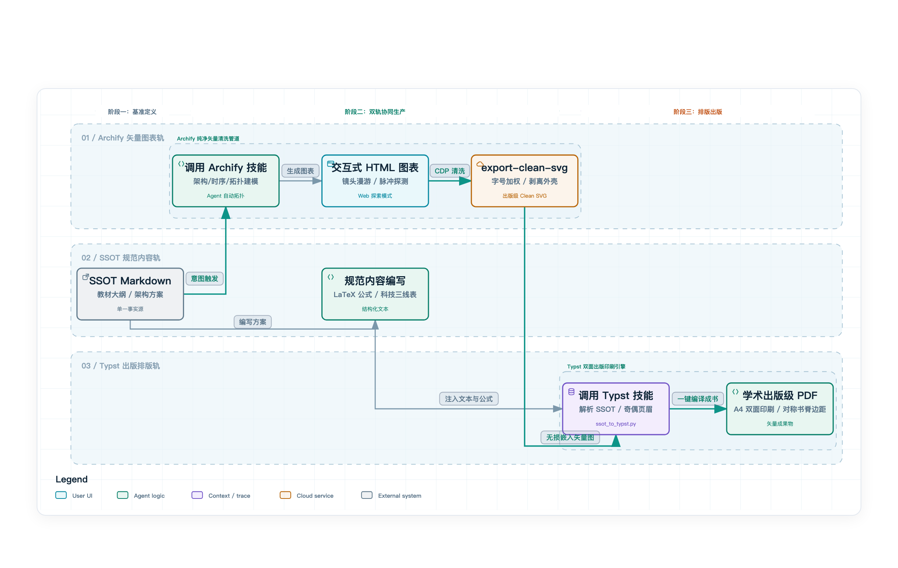
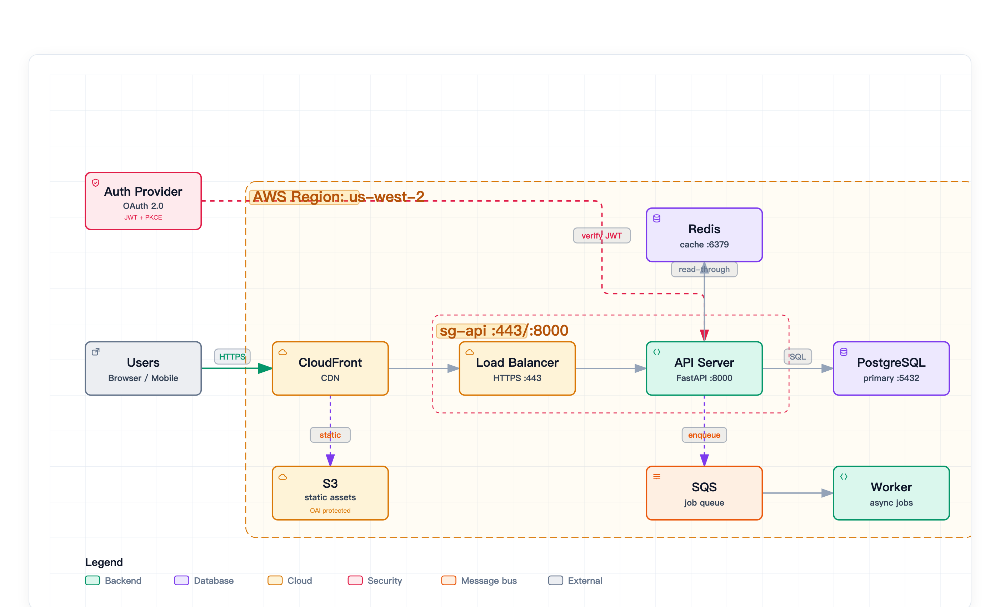
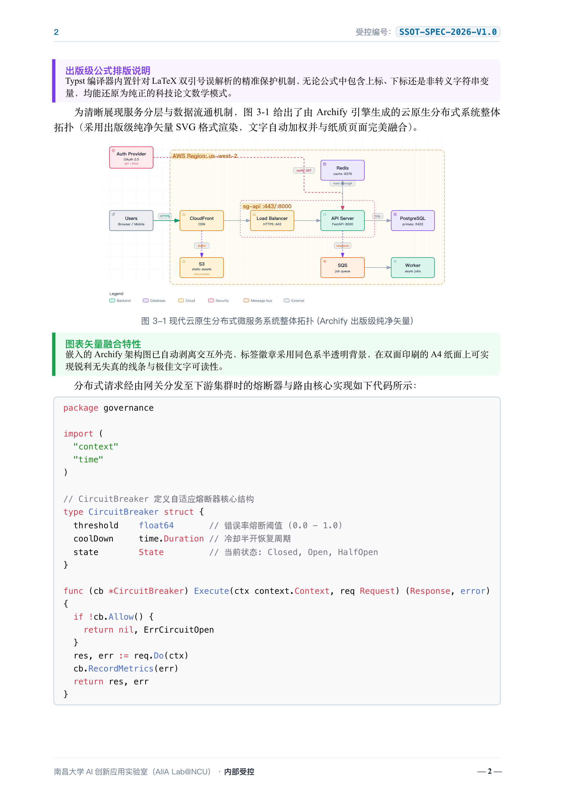

# AI 教育者 Agent 技能集 (Educator Toolkit Skills)

欢迎来到 **Educator Toolkit Skills**！这里汇集了专为 AI Coding Agent（如 Google Antigravity、Claude Code、Cursor、Codex 等）定制的专业级自动化技能包。

通过引入标准化的 Agent 技能，AI 助手不再只是通用的文本生成器，而是具备 **符合教育学规范、出版级排版精度和工程制图水准** 的专业助教。

---

## 🧭 技能清单 (Skills Catalog)

| 技能名称 | 目录 | 核心定位 | 关键能力 |
| :--- | :--- | :--- | :--- |
| **Archify** | [`skills/archify/`](./archify/) | 架构与工程可视化引擎 (基于开源项目改造) | <ul><li>支持架构图、时序图、数据流图、状态机等 5 大图表族</li><li>双轨模式：浏览器富交互探索 + 出版级纯净矢量（Clean SVG）导出</li><li>自动字号优化 (+2.5px)、半透明同色系徽章、无交互外壳残留</li><li>专为复杂系统拓扑与工程方案设计</li></ul> |
| **Textbook SVG** | [`skills/textbook-svg/`](./textbook-svg/) | 教材、报告与顶刊论文三轨制概念与架构矢量配图引擎 | <ul><li>**Track A 极简纯 SVG**：内置 `pillars` / `matrix` / `branch` / `contrast` 四大构图母版（700~760px 原生 XML，零外部依赖）</li><li>**Track B 高密度 1+N 图组**：锁定 `880px` 黄金窄画布与大字号体系，按“1 张全景总图 + N 张专题子图”解耦，彻底根治宽图缩印后“字如蚂蚁”痛点</li><li>**Track C 顶刊论文 Figure 1 机理与模型架构矢量图**：支持领域机理对比与多轨模型架构矢量主图，共享学术语义色板、原生数学公式与 PDF 印刷字号预检</li><li>内置 `DOM-to-Pure-SVG` 编译与 `2x Retina PNG` 双模输出，配套 `svg_tool.py` 自动拦截乱码、文字超框与字号过小</li></ul> |
| **Figures4Papers** | [`skills/figures4papers/`](./figures4papers/) | 顶会/顶刊学术论文定量实验数据科研制图引擎 | <ul><li>源自 *Nature Machine Intelligence* / *ICML* / *NeurIPS* / *ECCV* 真实发表级 Python/Matplotlib 制图范式</li><li>覆盖分组柱状图、消融实验、超宽多指标面板、时序收敛折线、极坐标雷达图、热力图与 3D 流形散点图</li><li>内置动态紧凑坐标轴缩放、独立图例画板、黑白打印安全纹理（Hatch/Edge）、有界指标脊线截断与版心反推最小印刷字号门禁</li></ul> |
| **Typst** | [`skills/typst/`](./typst/) | 单一事实源 (SSOT) 出版级 PDF/长图编译器 | <ul><li>A4 双面印刷排版（对称书脊装订边距、奇偶动态页眉）</li><li>科技论文三线表排版引擎</li><li>LaTeX 数学公式与变量双引号保护</li><li>集成 Kroki 多引擎图表编译（默认公共服务开箱即用）与原生矢量图嵌入</li></ul> |
| **Docx** | [`skills/docx/`](./docx/) | 单一事实源 (SSOT) 出版级 Word (`.docx`) 编译器 | <ul><li>A4 标准页面、动态页眉与页脚原生 `PAGE` 页码域</li><li>绑定 Word 原生 `Heading 1~3` 大纲层级，支持导航窗格与自动目录</li><li>中文正文 2em 首行缩进、五色 GitHub Callout 卡片、代码块卡片</li><li>“图下表上”防跨页撕裂、跨页自动重复表头的科技三线表与上标尾注文献</li></ul> |
| **Markdown CJK Spacer** | [`skills/markdown-cjk-spacer/`](./markdown-cjk-spacer/) | 中文与行内格式串盘古之白自动补全引擎 | <ul><li>精准识别紧贴汉字的 `**加粗**`、`**“加粗引号”**`、`` `code` ``、`*斜体*`</li><li>词法 Token 判定机制，杜绝同一行多个加粗块的跨块倒置误匹配</li><li>围栏代码块（` ``` `）与数学公式块（`$$`）完全免疫保护</li><li>支持单文件或全项目递归扫描，具备预览与就地修改双模式</li></ul> |
| **Lecture SSOT to Master** | [`skills/lecture-ssot-to-master/`](./lecture-ssot-to-master/) | 单一事实源 (`*.ssot.md`) 讲义后置五层精炼与多端衍生流水线 | <ul><li>从 `*.ssot.md` 自动执行去 AI 味净化、盘古之白与出版级 A4 PDF 编译</li><li>构建包含【正文、逐字稿、对白、自学解释、教学设计】五层结构的 `*.master.md` 与高密度学术 SVG 插图</li><li>内置双流编码容量预算与 Playwright 容器底部防截断门禁，一键衍生课堂演示 PPTX、学生自学 PDF 及学习通标准题库</li></ul> |

---

## ⚡ 核心联动工作流：出版级学术材料生产线

`Archify`、`Textbook SVG`、`Figures4Papers`、`Markdown CJK Spacer`、`Typst` 与 `Docx` 构成了完整的学术科研与公文出版生产流水线，彻底打破了“画图模糊、缩印字小、排版错位、格式割裂”的长期痛点：

<p align="center">
  
</p>

> 💡 **生产线全景架构解析**：
> 1. **单一事实源驱动 (SSOT)**：所有教材教案、调研报告、技术设计与拓扑架构均源自同一套受控 Markdown 文档，并通过 `Markdown CJK Spacer` 自动消除中西文与行内加粗粘连，杜绝解析异常；
> 2. **三引擎正交学术与工程制图**：针对交互式工程拓扑与时序状态调用 `Archify` 导出 Clean SVG；针对高校教材概念图、高密度架构卡片及顶刊论文 Figure 1 机理与模型架构主图，通过 `Textbook SVG` 三轨制引擎（Track A / B / C）直出纯矢量 `.svg` / `.pdf` 与 `2x Retina .png`；针对论文定量实验数据（SOTA 对比、消融、折线、雷达、热力图），调用 `Figures4Papers` 输出符合顶刊版心字号门禁的矢量图表；
> 3. **Typst / Docx 双栖出版**：同一份 Markdown 既可通过 `Typst` 输出符合国家学术标准的 A4 双面印刷矢量 PDF 与移动端无缝长图，也可通过 `Docx` 一键输出符合高校公文与教务申报规范的可编辑 Microsoft Word（`.docx`）文档。

---

## 🖼️ 生产线成果实测 (Visual Showcase)

> *注：以下示例基于脱敏通用的微服务架构与规范文档一键生成，不包含任何特定课程或业务信息。*

| 步骤一：Archify 导出出版级纯净矢量 (Clean SVG) | 步骤二：Typst 编译 A4 双面出版级教材 (Vector PDF) |
| :---: | :---: |
|  |  |
| *无 UI 交互外壳、字号加权提升、半透明同色系徽章* | *A4 双面排版、奇偶页眉、公式保护、三线表与矢量拓扑融合* |

---

## 💬 智能体调用指南：如何触发与使用各大 Skill (User Invocation Guide)

对于使用 AI 编程助手（如 **Google Antigravity**、**Claude Code**、**Cursor**、**Codex**、**Cline** 等）的普通用户与教育者，无需记忆底层复杂的脚本路径与终端参数，智能体原生支持两种极简的调用方式：**自然语言智能触发** 与 **斜杠命令（Slash Command）精准调度**。

### 方式一：自然语言触发（AI 智能识别，零记忆成本）

智能体已预加载各技能的意图识别契约，您只需像日常对话一样描述需求，AI 会自动识别并激活对应的 Skill：

#### 🎨 触发 Archify 绘图技能
- **绘制系统架构**：
  > *“帮我画一张电商订单系统的云架构图，包含网关、认证服务、订单微服务、Redis 缓存与 PostgreSQL 数据库，并导出为出版级清晰的纯净 SVG。”*
- **绘制时序交互**：
  > *“请画一张时序图，展示前端调用 API 登录、JWT 验证、写入缓存和查询数据库的完整调用链路。”*
- **Mermaid 转换美化**：
  > *“把我文档中这段粗糙的 Mermaid 架构图转换美化为出版级 Archify 矢量图。”*
- **学术插图纯净导出**：
  > *“将刚才生成的 HTML 图表清洗导出为无外壳、字号放大的出版级 Clean SVG，供论文排版使用。”*

#### 📐 触发 Textbook SVG 三轨制概念、教材与顶刊架构配图技能
- **绘制教材极简概念图（Track A）**：
  > *“请用 textbook-svg 为教材第 3 章绘制一张 2×2 四象限概念矩阵图（或横向三支柱闭环图），展示四类核心防御准则，并通过印刷门禁校验。”*
- **绘制高信息密度 1+N 架构图组（Track B，防缩印字小）**：
  > *“这张多层系统架构与团队分工图内容太多、缩印后字太小，请调用 textbook-svg 的 880px 1+N 模式拆解为 1 张全景总图和 3 张专题子图，同时导出 2x Retina PNG 与纯正矢量 SVG 并随文就近嵌入。”*
- **绘制顶刊论文 Figure 1 机理对比与模型架构矢量主图（Track C）**：
  > *“请调用 textbook-svg 的 Track C 模式，为论文绘制双栏宽度的 Figure 1 领域机理对比与多轨模型架构矢量主图，包含原生数学公式与统一学术色板，并通过 PDF 印刷字号门禁预检。”*

#### 📊 触发 Figures4Papers 顶会/顶刊定量实验制图技能
- **绘制多指标 SOTA 对比与消融柱状图**：
  > *“请根据 `results.tsv` 中的实测指标调用 figures4papers 绘制双栏横向多面板分组对比柱状图，带独立图例画板、黑白打印安全斜纹，并按 6.37 in 版心校验最小印刷字号。”*
- **绘制多维能力雷达图、收敛折线与热力图**：
  > *“请使用 figures4papers 为本论文的 6 项公开基准结果绘制极坐标雷达图与超参数扫描折线图，导出 Type 42 矢量 PDF 与 300 DPI PNG。”*

#### 📄 触发 Typst 排版与编译技能
- **教案/文档一键转教材**：
  > *“请使用 Typst 技能，将当前的 `docs/方案设计.ssot.md` 排版编译为符合高校教材标准的 A4 双面矢量 PDF。”*
- **公式与三线表规范排版**：
  > *“帮我把这份带有 LaTeX 复杂数学公式和三线表的教案编译成双面印刷 PDF，注意奇偶页眉和书脊装订边距。”*
- **两技能联动（图文一键成书）**：
  > *“请先调用 Archify 或 Textbook SVG 帮我绘制系统架构图并导出纯净 SVG，随后使用 Typst 将整篇设计方案与架构图编译为 A4 双面出版级 PDF 文档！”*

#### 📝 触发 Docx 出版级 Word 编译技能
- **调研报告/申报书一键转 Word**：
  > *“请将这份 Markdown 调研报告导出一份排版规范的 docx 版本，保留执行摘要卡片、三线表与上标尾注。”*
- **带插图与多级大纲的公文交付**：
  > *“帮我用 docx 技能把当前文档转成可编辑的 Word 文档，确保章节标题能直接在 Word 导航窗格跳转，正文首行缩进两字符。”*

#### ✨ 触发 Markdown CJK Spacer 盘古之白空格补全技能
- **单文件或全局行内格式串空格修复**：
  > *“请修复文档中所有紧贴中文字符的 `**加粗**` 和 `` `行内代码` `` 两侧缺失的空格。”*

---

### 方式二：斜杠命令方式直接调用（Slash Commands，直达目标）

在支持斜杠命令的 Agent（如 Antigravity IDE、Claude Code、Cursor Composer 等）中，可以直接在对话框中键入斜杠命令，直达特定技能任务：

#### 1. Archify 绘图斜杠命令
| 命令形式 | 典型调用示例 | 效果说明 |
| :--- | :--- | :--- |
| `/archify [类型] [需求描述]` | `/archify architecture 微服务云原生拓扑，含负载均衡、FastAPI、Redis 与 Postgres` | 直接生成可交互的架构拓扑 HTML |
| `/archify sequence [时序过程]` | `/archify sequence 用户下单、库存扣减、支付回调的时序流程` | 生成符合规范的分布式时序图 |
| `/archify clean [html路径]` | `/archify clean docs/figures/arch.html` | 一键清洗并提取出出版级纯净 SVG |
| `/archify convert [mermaid/代码]`| `/archify convert docs/diagrams/legacy.mmd` | 智能升级现有 Mermaid 图表为 Archify |

#### 2. Textbook SVG 三轨制配图斜杠命令
| 命令形式 | 典型调用示例 | 效果说明 |
| :--- | :--- | :--- |
| `/textbook-svg [母版] [需求描述]` | `/textbook-svg pillars 感知-决策-执行三支柱及底部反馈闭环` | 生成 700~760px 极简纯 SVG 概念图（Track A）并通过 `lint` 门禁 |
| `/textbook-svg 1+N [复杂架构需求]` | `/textbook-svg 1+N 端云四层架构与多团队交付矩阵` | 生成 `880px` 黄金窄画布总图+专题子图（Track B），直出 `2x PNG` 与纯正 `.svg` |
| `/textbook-svg paper-fig [论文架构需求]` | `/textbook-svg paper-fig Figure 1 领域机理对比与双轨可微网络架构图` | 生成顶刊论文 Figure 1 机理与模型架构矢量图（Track C），执行 PDF 印刷字号预检 |
| `/textbook-svg lint [目录/文件]` | `/textbook-svg lint docs/assets/` | 对 SVG 插图执行乱码、文字超框与箭头方向一致性校验 |

#### 3. Figures4Papers 定量科研制图斜杠命令
| 命令形式 | 典型调用示例 | 效果说明 |
| :--- | :--- | :--- |
| `/figures4papers bars [数据路径/描述]` | `/figures4papers bars 基于 results.tsv 绘制四指标 SOTA 分组对比与消融柱状图` | 生成带独立图例轴、黑白安全纹理与动态紧凑缩放的顶会矢量柱状图 |
| `/figures4papers radar [数据路径/描述]` | `/figures4papers radar 多任务公开基准能力雷达图与后训练收敛折线` | 生成顶刊语义配色的极坐标雷达图或时序置信带曲线（PDF + PNG） |

#### 4. Typst 编译斜杠命令
| 命令形式 | 典型调用示例 | 效果说明 |
| :--- | :--- | :--- |
| `/typst [文档路径]` | `/typst docs/技术方案.ssot.md` | 一键解析并生成 Typst 源码与 A4 双面 PDF |
| `/typst compile [md文件] [pdf路径]` | `/typst compile docs/lecture-01.md output/lecture-01.pdf` | 指定输出路径进行出版级编译 |
| `/typst [文档路径] --margin-inner [值]`| `/typst docs/book.md --margin-inner 28mm` | 针对厚本书脊装订定制边距并编译 |

#### 5. Docx 编译斜杠命令
| 命令形式 | 典型调用示例 | 效果说明 |
| :--- | :--- | :--- |
| `/docx [文档路径]` | `/docx docs/调研报告.md` | 一键解析并在同目录生成出版级 `.docx` 文档 |
| `/docx [md文件] [docx路径]` | `/docx docs/report.md output/report.docx` | 指定输出路径生成 Word 文档 |
| `/docx [文档路径] --header [文本]` | `/docx docs/report.md --header "高校通识教育改革调研"` | 自定义 Word 右上角页眉文本 |

#### 6. Markdown CJK Spacer 斜杠命令
| 命令形式 | 典型调用示例 | 效果说明 |
| :--- | :--- | :--- |
| `/markdown-cjk-spacer [文档路径]` | `/markdown-cjk-spacer docs/调研报告.md` | 自动扫描并补全指定文件中紧贴汉字的行内格式串外侧空格 |
| `/markdown-cjk-spacer [目录路径]` | `/markdown-cjk-spacer .` | 递归扫描并批量修复目录下所有 `.md` 文件的格式串间距 |

> 💡 **智能体工作机制提示**：
> 当您键入 `/archify`、`/textbook-svg`、`/figures4papers`、`/typst`、`/docx` 或 `/markdown-cjk-spacer` 时，智能体会分别加载对应的 `SKILL.md`。各技能既可独立调用，亦可在单轮对话中无缝串联，从同一份受控 Markdown 单一事实源与实验数据表同步产出高清矢量/位图插图、出版级 PDF 与可编辑 Word（`.docx`）。

---

## 🛠️ 如何在您的 AI Agent 中安装与配置

### 1. Google Antigravity / Gemini CLI
将技能目录克隆或软链接至 Agent 技能根目录：
- **全局生效**：放入 `~/.gemini/config/skills/`
- **项目级生效**：放入项目根目录下的 `.agents/skills/`

例如：
```bash
# 在您的项目工程根目录下
mkdir -p .agents/skills
cp -r path/to/educator-toolkit/skills/* .agents/skills/
```

### 2. Cursor / Codex / Claude Code
将对应的 `SKILL.md` 内容作为 System Instructions 或 Custom Rules 引入，或者通过项目提示词规则文件（如 `.cursorrules`、`CLAUDE.md`）显式引用该目录下的执行脚本：
```markdown
When generating interactive architecture diagrams or exporting clean SVG figures, reference `skills/archify/SKILL.md`.
When illustrating textbook concepts (Track A), high-density 880px 1+N architecture suites (Track B), or top-venue paper Figure 1 mechanism and model architecture schematics (Track C), reference `skills/textbook-svg/SKILL.md` and use `skills/textbook-svg/scripts/svg_tool.py`.
When plotting publication-grade quantitative experimental figures (grouped bars, ablations, radar, trend lines, heatmaps) with Python/Matplotlib, reference `skills/figures4papers/SKILL.md`.
When compiling SSOT Markdown into publication-grade PDF/PNG documents, use `python3 skills/typst/scripts/ssot_to_typst.py`.
When exporting Markdown/SSOT documents to publication-grade Word (.docx), use `python3 skills/docx/scripts/md_to_docx.py`.
```

---

## 🙏 开源致谢 (Acknowledgements)

- **[`ChenLiu-1996/figures4papers`](https://github.com/ChenLiu-1996/figures4papers)**（**CC BY-NC 4.0**）：诚挚感谢耶鲁大学 **[Chen Liu（刘晨）博士](https://chenliu-1996.github.io/)** 开源的顶刊顶会（*Nature Machine Intelligence* / *ICML* / *NeurIPS* / *ECCV*）科研图表 Python 代码库、学术语义色板与 `scientific-figure-making` 设计理论，构成了 [`skills/figures4papers/`](./figures4papers/) 的核心底座，并为 [`skills/textbook-svg/`](./textbook-svg/)（Track C）提供了学术视觉规范参考。
- **[`Cocoon-AI/architecture-diagram-generator`](https://github.com/Cocoon-AI/architecture-diagram-generator)**（**MIT**）：感谢上游开源项目为 [`skills/archify/`](./archify/) 提供的现代系统架构交互可视化基础。

---

## 🤝 贡献与反馈

欢迎各位教育同行与开发者提交新的 Agent 技能或改进现有技能！
如遇问题或建议，欢迎在 GitHub 仓库提交 Issue 或 Pull Request。
