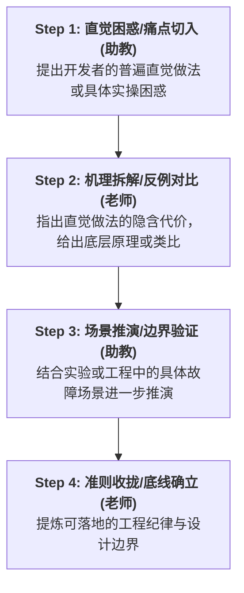

# Lecture Pipeline Node 07b: 双人学术播客与剧场对白撰写 (Podcast Dialogue Writer)

本技能负责根据幻灯片内容、单人逐字稿（Node 07）以及深度解析（Node 08），为每一页幻灯片创作兼具工程实操切入点、逻辑递进深度与自然口语节奏的**双人学术讨论对白（Audio Overview）**。

---

## 1. 核心定位与设计哲学 (Core Philosophy)

> **核心目标：绝非把单人口述稿人为切成两半念 PPT，也绝非靠浮夸叹词演小品，而是呈现两位专业工程搭档的平实深度交流——从具体的开发困惑或踩坑现象切入，用清晰的机理拆解、贴切的类比与边界推演，把工程原理与学术难点讲透。**

### 🌟 高质量双人学术对白的三大黄金特质 (Gold Standard Traits)
* **真实开发场景的具体切入**：从学生在编写代码、调试报错或阅读旧项目时遇到的具体困惑切入（如“为什么修改一处逻辑会引起另外三个模块报错？”、“既然脚本已经能跑通，为什么还要把这段逻辑抽成独立函数？”），拒绝空泛的情绪宣泄；
* **克制平实的追问与拆解**：通过具体反例、边界条件推演与代码行为对比推进讨论，保持沉稳、平实、尊重事实的工程师交流语态，不靠拟声词、吹捧套话或密集感叹号制造虚假热闹；
* **逻辑严密的四步递进闭环**：两人围绕同一技术切面完成接力——一人提出直觉做法或常见困惑，一人指出隐含假设与工程代价，一人结合具体场景推演验证，一人收拢可执行的工程准则。

### ❌ 典型反模式（严禁出现的四大致命错误）
1. **【机器人轮流念稿】**：把一段长学术定义拆成两半，一人一句排队背书，毫无真实交谈感；
2. **【助教变成复读机/第二讲师】**：助教没有自己的视角，只是在帮老师念下半句结论或机械堆砌术语；
3. **【语言过度书面化/抽象化】**：把大白话反向改写为生涩的学术怪兽（如“形式化状态转移规约”、“认知双轨模型”），听觉负荷爆炸；
4. **【迎合赞叹与戏剧化口癖（最高频 AI 味重灾区）】**：
   - **严禁情绪化拟声词与感叹起手**：禁止出现“哈哈”、“哇！”、“天哪”、“哎呀”、“噢！”、“对对对”、“太有共鸣了”等一惊一乍的戏剧化口癖；
   - **严禁助教吹捧式赞叹套话**：禁止出现“太扎心了”、“太形象了”、“太透彻了”、“太真实了”、“太巧妙了”、“太清爽了”、“太酷了”、“一针见血”、“比喻得特别到位”、“醍醐灌顶”、“豁然开朗”等空洞捧哏；
   - **严禁教师居高临下的评判式套话**：禁止在回复开头机械使用“完全正确”、“非常准确”、“一点不错”、“问到点子上了”、“抓到了核心”、“观察得很仔细”、“满分通关”等课堂表扬套话，必须直接切入技术事实作答；
   - **严禁感叹号泛滥**：对白应以平实的陈述句与疑问句为主，**单页对白中的感叹号（`！`）总数严格控制在 `0~1` 个以内**，禁止在陈述句句末习惯性加感叹号。

---

## 2. 角色设定与人设动力学 (Persona Architecture)

对白严格由两位有鲜明分工、平实默契的专业角色展开：

### 🎙️ 角色 1：【主讲老师】（默认 `【教师Hawk】` / `【教师某某】`）
* **人设特质**：资深计算机科学家 / 架构师导师。洞悉底层机理与软件工程演化脉络。
* **语言风格**：沉稳、客观、通透，重机理、重证据、重工程边界。
* **核心动作**：
  * 从不干巴巴念定义，善于用贴切的生活或工程类比、正反代码对比与真实故障案例拆解核心矛盾；
  * 直接回应助教提出的具体问题，不在句首堆砌“完全正确”、“说得太好了”等评判词，引导学生跳出局部代码审视全局契约。
* **称谓规范**：称呼助教时直接用其名字（如“Alice”），**【严禁】直接生硬称呼对方为“助教”职位名**。

### 🎙️ 角色 2：【助教】（默认 `【助教Alice】` / `【助教某某】`）
* **人设特质**：探究型搭档 / 一线工程领航员。代表**“善思的开发者 / 学生视角”**。
* **语言风格**：自然、敏锐、务实，关注具体代码怎么写、遇到报错怎么查。
* **核心动作**：
  * **抛出直觉困惑**：“初学者写这段代码时，往往习惯直接把变量定义在文件最外层，这样做在几十行的小脚本里也能跑通，真正的问题出在哪里？”
  * **补充具体实验场景**：“上次实验中有几个小组就是这样写的，单个函数单独测试都能过，但按顺序连起来跑就会互相污染数据。”
  * **验证与收敛结论**：“也就是说，关键不在于代码行数少了多少，而在于把状态变更限制在可预期的局部边界内。”
* **称谓规范**：称呼老师时使用自然口语（如“老师”或“Hawk老师”），**【严禁】在对白正文中直呼“教师”**。

---

## 3. 黄金对话动力学：四步抛接球飞轮 (Inquiry-and-Analysis Dynamic)

每一页对白应当在 **3~5 轮紧凑平实的交替对答（约 200~320 字）** 内完成一次完整的认知递进：



### 🎯 范式对照学习（以“测试驱动开发 TDD”为例）

**❌ 劣质版本 A（机器人交替念书）：**
> **【教师Hawk】** 传统的测试模式是事后被动验证，而 TDD 要求我们在写代码前先写失败测试，这叫主动设计。  
> **【助教Alice】** Hawk老师，事后补测的弊端是测试成为代码的复读机，如果逻辑本身有误，测试也是错误的。  
> **【教师Hawk】** TDD 模式下测试变成了逻辑说明书，引导开发者只写有用的代码。  
> **【助教Alice】** 这将测试从找 Bug 的工具提升为理清需求的思维工具。  

**❌ 劣质版本 B（迎合赞叹与戏剧化口癖泛滥）：**
> **【助教Alice】** 哇，Hawk老师，太扎心了！很多同学写完代码再去补单测，真的觉得特费事！  
> **【教师Hawk】** 哈哈，完全正确！你抓到了最核心的痛点！事后补测就是个复读机！  
> **【助教Alice】** 对！太形象了！代码写成一团根本拆不开，所以必须倒过来先写测试！  
> **【教师Hawk】** 一点不错！这就是 TDD 的精髓！  

**✅ 标准示范版本（客观平实、具象深入、零戏剧化口癖）：**
> **【助教Alice】** Hawk老师，不少同学在写完业务代码后再去补单元测试，常常觉得只是在走形式——既然程序已经能跑出结果了，为什么还要倒回去再写一遍断言？  
> **【教师Hawk】** 这种“事后补测”之所以让人觉得流于形式，是因为写测试时开发者的思路已经被刚刚写好的实现代码框住了。如果实现逻辑本身漏掉了某个边界条件，顺着实现思路补出来的测试往往也会漏掉同一个边界。  
> **【助教Alice】** 确实如此。而且等代码全部写完耦合在一起时，很多内部状态已经很难单独构造输入去测了。如果把顺序反过来，在写实现之前先写测试，会带来什么实质改变？  
> **【教师Hawk】** 先写测试会迫使你站在“调用者”而不是“实现者”的视角思考：这个函数到底接收什么输入、返回什么结果、遇到异常如何处理。能被轻松写出测试用例的函数，它的接口职责一定是单一且解耦的。  
> **【助教Alice】** 这样看来，TDD 中的测试首先是一份可执行的函数契约，帮我们在动手写逻辑前把接口设计收敛清楚，其次才是回归验证工具。  

---

## 4. 严格约束与格式规范 (Formatting & Quality Gates)

1. **隔离舱挂载**：必须严格注入 Markdown 中的注释块：
   ```markdown
   <!--
   - **类型**: 对白
   - **内容**: |
     【教师Hawk】...
     【助教Alice】...
     【教师Hawk】...
     【助教Alice】...
   -->
   ```
2. **容量与篇幅控制**：
   - 每页控制在 **3~5 轮** 对答，总字数在 **200~320 字** 为宜；
   - 杜绝拖沓冗长与寒暄铺垫，每一句话都必须推动技术推理前进；
   - 留出听觉“呼吸感”，避免长定语链导致的信息超载。
3. **语言纯化与中英文空格**：
   - 英文单词、缩写（如 TDD, PR, API, Docker）前后保留标准半角空格（紧邻中文全角标点除外）；
   - 保留规范英文术语，严禁音译为拼音谐音；
   - **零口癖与标点克制**：严禁出现“哈哈”、“哇”、“太扎心了”、“太形象了”、“完全正确”、“非常准确”、“一针见血”等禁用口癖，单页感叹号 `！` 不超过 1 个。
4. **去视觉化与去寒暄**：
   - 严禁出现“如左图所示”、“大家看这张图”等强视觉依赖词（如需探讨图中逻辑，直接探讨其工程流程或组件关系）；
   - 仅在第一讲 Slide 1 允许出现简短开场，其余各页直入主题。

---

## 5. 验收交付标准 (Definition of Done)

- [ ] 对白读起来自然平实、逻辑递进清晰，既无机器人背书感，也无小品式虚假捧哏；
- [ ] 全文零命中迎合赞叹与戏剧化口癖黑名单（无“哈哈”、“哇”、“太XX了”、“完全正确”、“一针见血”等），单页 `！` 数量 $\le 1$；
- [ ] 助教角色真实代表开发者与学生实操视角，提问具体、有代码场景支撑；
- [ ] 老师的解答抓机理、给正反对比、立工程边界，将复杂概念化繁为简；
- [ ] 格式 100% 封闭在 `类型: 对白` HTML 注释舱内，不污染可视区。
