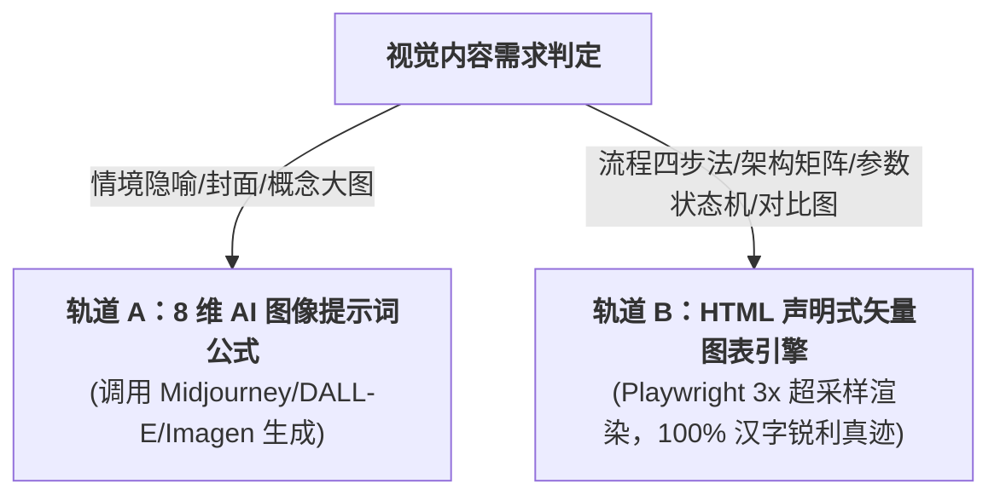

# Lecture Pipeline Node 10: 视觉架构师与图表渲染器 (Vision & Diagram Architect)

本技能负责根据双重编码理论（Dual-Coding Theory）为数字教材与幻灯片构建高品质、高可读性的视觉资产。

---

## 1. 核心定位与双轨渲染架构 (Dual-Track Architecture)

为了彻底根除扩散模型（Diffusion Models）在渲染复杂汉字与多步流程图时产生的**“错字乱码、字符粘连、缩放模糊”**致命缺陷，Node 10 实行严格的**双轨分流机制**：



---

## 2. 轨道 A · 概念与情境大图 (Conceptual & Atmospheric Imagery)

*适用场景*：封面背景图、学术历史情境再现、哲学隐喻插画。

### 8 维标准动态生图指令公式：
在 Markdown 占位符 `![Vision Placeholder | 生图指令：...]` 中必须包含：
1. `[宽高比 (Aspect Ratio)]`：封面用 `16:9`，单页主图用 `4:3`，双栏混排用 `1:1` 或 `16:9`；
2. `[版式类型 (Layout Type)]`：全屏背景 / 侧边辅助插画；
3. `[文化表现锚 (Cultural Anchors)]`：亚洲年轻高校师生、现代科研环境；
4. `[留白控制 (Negative Space)]`：指定主体偏移与干净留白区域，防止遮挡文字；
5. `[认知负荷度 (Complexity)]`：重逻辑走极简，Hook 悬念页走细节震撼；
6. `[构图视角 (Camera Angle)]`：特写 / 等距视角 (Isometric) / 宏大全景；
7. `[调色情绪 (Palette & Mood)]`：科技冷色调（深灰蓝 #0f172a、电光蓝 #0284c7、薄荷绿 #10b981）；
8. `[艺术风格 (Style Profile)]`：扁平插画 (Flat Vector) / 3D 磨砂玻璃 / 科普写实。

---

## 3. 轨道 B · 结构化技术图表与工作流 (Structured Technical Diagrams)

*适用场景*：**【强制执行】** 凡涉及**四步法工作流、系统架构、状态流转、数据输入输出管道、参数矩阵对比**，**一律禁止使用扩散模型生图，强制采用 HTML/SVG 声明式代码或通过 4090 Kroki MCP 编译高清矢量 SVG / 3x 离线渲染！**

### 🎨 工业级技术图表设计系统标准 (Infographic & Vector Design System)
1. **纯正中文字符排印与单引号字体声明（100% 汉字清晰度）**：
   - 必须使用系统原生中文字体栈：`-apple-system, BlinkMacSystemFont, 'PingFang SC', 'Hiragino Sans GB', 'Microsoft YaHei', sans-serif`（在 SVG style 中必须使用**单引号**，严禁使用双引号破坏 XML 解析）；
   - 核心步骤标题：**$\ge 19\text{px}\sim 23\text{px}$ 特粗加粗**（`font-weight: 800`，深色 `#0f172a`）；
   - 步骤序号/徽章：**$\ge 13\text{px}\sim 15\text{px}$**；
   - 角色胶囊标签：**$\ge 14\text{px}\sim 16\text{px}$**。
2. **画布画幅与 2×2 / 3 步矩阵严格对称几何对齐**：
   - **黄金比例**：矩阵/架构图控制在 `16:9 ~ 2:1`（如 `760px × 370px`）；横向流程图控制在 `3.5:1 ~ 4.3:1`（如 `800px ~ 850px × 195px`）；
   - **严格等宽等高**：同一层级/矩阵内所有卡片尺寸必须 100% 绝对一致（如 2×2 矩阵为 `350px × 155px`，3 步流程图为 `230px × 155px`），消除由于文字长度差异产生的高矮胖瘦；
   - **卡片内部微排版**：**卡片标题绝对居中（`text-anchor='middle'`）**，带 1px 细分割线；**列表条目绝对左对齐**（所有 Emoji 徽章、粗体标签与竖线 `|` 在左侧形成坚挺的垂直直线）；
   - **右侧防溢出留白**：文案必须精炼对齐，卡片右侧必须预留 **$\ge 25\text{px} \sim 35\text{px}$ 安全防溢出留白**。
3. **流程图过渡箭头长度与空间舒展度**：
   - **间距与箭头长度**：卡片间距预留 **`50px ~ 60px`**，过渡箭头直线长度必须 **$\ge 40\text{px} \sim 50\text{px}$**，确保流转指向醒目、舒展；
   - **双向尖角 Marker 规范**：使用标准锐角 `<polygon points="0,2 7,5 0,8"/>` 配合 `orient="auto"` 和 `refX="7"`，确保双向均自动呈现锐利箭头，杜绝平头；
   - **源头主动动作原则**：连线文字标注必须严格表示源头实体主动发起的动作（如人类下达意图、AI交付代码）。
4. **配色体系规范（四阶品牌色卡）**：
   - 步骤 1 / 角色 R（顶层设计/人类主导/角色）：梦幻紫（背景 `#faf5ff`，边框 `#a855f7`，文字 `#6b21a8`）；
   - 步骤 2 / 目标 O（算力加速/AI 辅助/目标）：科技蓝（背景 `#f0f9ff`，边框 `#0284c7`，文字 `#0369a1`）；
   - 步骤 3 / 约束 C（质量把关/安全防御/约束）：暖阳橙（背景 `#fff7ed`，边框 `#f97316`，文字 `#c2410c`）；
   - 步骤 4 / 验收 A（自动派生/交付出口/验收）：翡翠绿（背景 `#f0fdf4`，边框 `#22c55e`，文字 `#15803d`）。
5. **渲染方式与管线**：
   - **矢量输出 (SVG)**：调用 4090 Kroki MCP 接口或 Python SVG 引擎生成无损矢量 SVG，必须通过 XML 解析器闭环校验，适用于 Typst / Markdown 教材；
   - **位图输出 (PNG)**：调用 Playwright 以 `device_scale_factor: 3.0`（可选 `omit_background: true` 透明底色；参考视口：双栏半幅 `560px × 440px`、单页全幅 `1000px × 600px`）执行 3x Retina 无损渲染，适用于大屏幻灯片。

---

## 4. 自动化渲染工具调用规范 (Renderer Execution)

当需要生成或更新技术图表时，直接调用通用脚本：
```bash
python3 publishing/scripts/diagram_renderer.py \
  --template workflow_4step \
  --output "publishing/content/human-ai-collaboration/第X周/image/第X讲.master/diagram_name.png" \
  --data '{"step1":"人类拟定大纲","step2":"AI结构化扩充","step3":"人类严格核查","step4":"一键多端交付"}'
```

---

## 5. 验收交付标准 (Definition of Done)

- [ ] 逻辑图表中**绝对不存在错别字、乱码、笔画缺失**；
- [ ] 中文字号与幻灯片正文同等醒目（在大屏投影与缩放预览下清晰可辨）；
- [ ] 画布尺寸与幻灯片分栏完美嵌合，0 黑色大边框，0 视口几何溢出；
- [ ] 资产存放在专属 `image/` 子目录下，引用路径符合平台规范。
