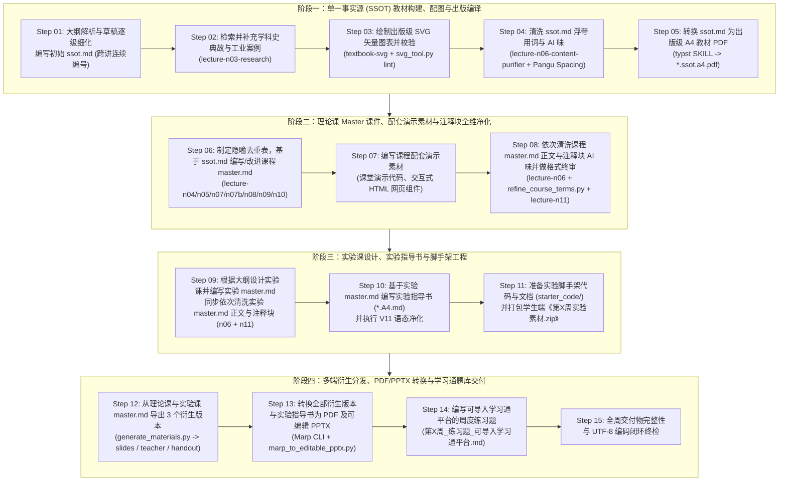

# Lecture Pipeline Orchestrator (全栈备课与多端出版大流水线)

本技能作为智慧课程平台的**顶层主调度器（Master Orchestrator）**，确立了 **“单一事实源优先（SSOT-First） → 理论与实验双轨展开 → 全维去 AI 味净化 → 一源多端自动化编译”** 的 15 步标准化备课工程流水线。

---

## 一、 全栈备课 15 步全局拓扑图 (Pipeline Topology)



---

## 二、 15 步标准执行规程与子技能调用明细 (Step-by-Step SOP)

### 阶段一：单一事实源（SSOT）教材构建、配图与出版编译

#### Step 01：根据教学大纲和草稿，编写 `ssot.md`（无草稿时先逐级细化完成草稿）
* **输入**：课程教学大纲（Syllabus）及已有讲义草稿（或舊版课件）。
* **核心动作**：
  1. **无草稿时的逐级细化**：若仅有大纲而无草稿，先调用 `lecture-n01-objective`（确立基于布鲁姆分类学的阶梯教学目标）与 `lecture-n02-strategy`（基于加涅九大教学事件设计主支线），将章节骨架逐级扩写为包含完整技术推导、代码示例与小结测验的详尽草稿；
  2. **重构为标准 SSOT 教材**：调用 `lecture-ssot-distiller`，编写未受表现层标签污染（无 `<div>`、无 `---` 分页符、无口语指示词）、段落连贯流畅的通用教材风格 `*.ssot.md`；
  3. **【跨讲连续编号铁律】**：当同一教学周的两讲共同构成同一章的上、下篇时，下篇（偶数讲）的二级章节号（`## X.Y`）、三级小节号（`### X.Y.Z`）、表格编号（`表X-Y`）与插图编号（`图X-Y`）必须紧接上篇（奇数讲）的末尾编号连续顺延，严禁在下篇重置为 `X.1`、`表X-1` 或 `图X-1`。
* **调用子技能**：`lecture-n01-objective`、`lecture-n02-strategy`、`lecture-ssot-distiller`。
* **产出文件**：`<讲次名称>.ssot.md`。

#### Step 02：为 `ssot.md` 补充相关案例和故事
* **输入**：Step 01 产出的 `<讲次名称>.ssot.md`。
* **核心动作**：
  1. 调用 `lecture-n03-research`，针对讲义中的核心抽象概念、语法规则或工程红线，检索权威真实的计算机科学史典故（如图灵奖得主手稿、算法发明背景）、知名工业界故障复盘（Postmortem）或顶尖高校（MIT / Stanford / CMU / UC Berkeley）经典课程对标案例；
  2. 以 GitHub Callout 卡片（`> [!NOTE]`、`> [!TIP]`、`> [!WARNING]`、`> [!IMPORTANT]`）形式自然嵌入对应章节末尾（每讲补充 4～6 则，激发学生学习兴趣）；
  3. **排版约束**：Callout 首行加粗标题内严禁混入 LaTeX 数学宏（如 `$\rightarrow$`），统一使用纯文本或 Unicode 符号 `→`；严禁将两个 Callout 块直接相邻放置。
* **调用子技能**：`lecture-n03-research`。

#### Step 03：绘制出版级 SVG 矢量图表并校验
* **输入**：`*.ssot.md` 中涉及的系统架构、演进流程、2×2 矩阵与对比模型。
* **核心动作**：
  1. 彻底清除正文中的 ASCII 字符画，调用 `textbook-svg` 技能将其绘制为 `viewBox` 宽度 `700px ~ 760px`、同层卡片 100% 绝对等宽等高、标题居中且列表严格左对齐、零 Emoji 的出版级矢量图 `image/**/fig*.svg`；
  2. 执行强制门禁校验：
     ```bash
     uv run ~/.gemini/config/skills/textbook-svg/scripts/svg_tool.py lint <svg_dir> --output /tmp/svg_lint.json
     ```
     确保返回 0 错误。
* **调用子技能**：`textbook-svg`。

#### Step 04：清洗 `ssot.md` 中的浮夸用词和 AI 味
* **输入**：补充完故事与图表的 `<讲次名称>.ssot.md`。
* **核心动作**：
  1. 调用 `lecture-n06-content-purifier`，按 V11 规范扫描并强制替换黑名单词汇（如：`级联` → `连锁/链式`、`雪崩` → `稀释/骤降/连锁瘫痪`、`绝境/实操战场` → `执行困境/具体工程场景`、`坚不可摧/生命线` → `高可靠性/核心约束`、`爆仓/撑爆` → `窗口超限/过载`、剔除非必要场景下的冗余 `物理`、`高保真`、`正交` 修饰）；
  2. **受众视角净化**：消除局限性内部课堂口吻（如“在第 X 周实验课上”、“所有同学”、“老师，”、“大一课堂”等），统一升级为面向全体学习者与软件开发者的客观学术工程语态；
  3. **Pangu Spacing 校验**：调用 `markdown-cjk-spacer` 规则，确保所有加粗块（`**...**`）、加粗引号（`**“...”**`）、行内代码（`` `...` ``）及英文数字与周围中文字符之间保留标准半角空格。
* **调用子技能**：`lecture-n06-content-purifier`、`markdown-cjk-spacer`。

#### Step 05：转换 `ssot.md` 为出版级教材（Typst A4 PDF）
* **输入**：净化完毕的 `<讲次名称>.ssot.md`。
* **核心动作**：
  1. 校验 `image/` 目录下所有 `.png` 图片文件头是否为真实 PNG 编码（防止 JPEG/WebP 伪装后缀导致 Typst 解码报错）；
  2. 调用 `typst` 技能编译器生成双面出版级 A4 教材 PDF：
     ```bash
     COMPILER="$(python3 -c 'import os, sys; print(os.path.realpath(os.path.expanduser(sys.argv[1])))' ~/.gemini/config/skills/typst/scripts/ssot_to_typst.py)"
     python3 "$COMPILER" "<讲次名称>.ssot.md"
     ```
* **调用子技能**：`typst`。
* **产出文件**：`<讲次名称>.ssot.a4.typ`、`<讲次名称>.ssot.a4.pdf`。

---

### 阶段二：理论课 Master 课件、配套演示素材与注释块全维净化

#### Step 06：基于 `ssot.md` 编写 `master.md`（已有 `master.md` 时进行改进）
* **输入**：`<讲次名称>.ssot.md`（及已有的 `<讲次名称>.master.md`）。
* **核心动作**：
  1. **【前置强制：生成隐喻排期去重表（Metaphor Plan Manifest）】**：严格限制“学骑自行车”等高频类比在全讲出现不超过 1 次；跨页再次涉及控制或试错概念时，必须改用“钢琴调音”、“驾驶导航”等非重复隐喻或显式承接前文；
  2. **建构主义打磨与五维内容装配**：
     - 调用 `lecture-n04-strategy-review` 与 `lecture-n05-slides-writer` 编写或改进幻灯片可视区正文与代码块（同步将 `ssot.md` 中新增的精华历史典故与 SVG 图表反哺融入 `master.md`）；
     - 调用 `lecture-n07-script-writer` 撰写 `<!-- - **类型**: 逐字稿 -->`（单人口语讲稿）及 `<!-- - **类型**: 教学设计 -->`（含教学时间、教学目标、课堂启发设问）；
     - 调用 `lecture-n07b-podcast-dialogue`（按需）撰写 `<!-- - **类型**: 对白 -->`（双人播客剧场对白）；
     - 调用 `lecture-n08-deep-dive` 撰写 `<!-- - **类型**: 解释 -->`（学生自学导读与难点深潜）；
     - 调用 `lecture-n09-layout` 与 `lecture-n10-vision` 完成 Marp 响应式网格卡片布局与配图注入；
  3. **【安全红线】**：修改已有 `master.md` 时，必须以 `---` 为边界、**严格以“单张 Slide”为最小原子操作单元**（或通过独立 Python 脚本在内存中完成 UTF-8 闭环校验后整文件原子写入），严禁跨越多页执行大段模糊替换。
* **调用子技能**：`lecture-n04-strategy-review`、`lecture-n05-slides-writer`、`lecture-n07-script-writer`、`lecture-n07b-podcast-dialogue`、`lecture-n08-deep-dive`、`lecture-n09-layout`、`lecture-n10-vision`。
* **产出文件**：`<讲次名称>.master.md`。

#### Step 07：编写课程配套演示素材（代码、交互式网页等）
* **输入**：`<讲次名称>.ssot.md` 与 `<讲次名称>.master.md` 中的核心教学演示点。
* **核心动作**：
  1. 编写供教师课堂现场运行的演示代码脚本（如分阶段演进的源码示例）；
  2. 针对抽象动态过程（如内存引用变化、事件循环流转、状态机迁移），编写可离线打开的交互式 HTML 教学演示网页或可视化小工具（存放于当周课程子目录如 `L13_variables_blueprints/` 下）。
* **调用子技能**：`generative_ui`（及前端/Python 工程构建）。

#### Step 08：依次清理课程 `master.md` 正文和注释块中的浮夸用词和 AI 味，并执行格式终审
* **输入**：Step 06 产出的 `<讲次名称>.master.md`。
* **核心动作（双通道深度净化，严防注释块漏网）**：
  1. **第一通道（可视区正文 + 四大隐藏注释块逐一净化）**：
     依次扫描并清理 `master.md` 的 **① 幻灯片可视区正文**、**② `类型: 逐字稿` 注释块**、**③ `类型: 教学设计` 注释块**、**④ `类型: 解释`（自学导读）注释块**、**⑤ `类型: 对白` 注释块**：
     - 严格执行 `lecture-n06-content-purifier` 黑名单替换（清除“级联、雪崩、绝境、坚不可摧、爆仓、高保真、正交、彻底杜绝、定海神针”及冗余“物理”修饰）；
     - **清零 `对白` 层的迎合赞叹与戏剧化口癖**：全面扫描并清除 `对白` 注释块中的情绪化拟声词（“哈哈”、“哇”、“天哪”、“哎呀”）、吹捧赞叹词（“太扎心了”、“太形象了”、“太透彻了”、“太真实了”、“太巧妙了”、“一针见血”、“醍醐灌顶”、“豁然开朗”）及套路化评判词（“完全正确”、“非常准确”、“一点不错”、“问到点子上了”、“满分通关”），并将单页对白中的感叹号 `！` 严格控制在 $0\sim 1$ 个以内；
     - **清零 `教学设计` 层的自夸式修辞**：清除“极具课堂互动效果”、“极具视觉冲击力”、“巧妙呼应”、“完美闭环”等主观自夸表述；
     - **清除底层文件名与工程改稿备注**：严禁在正文或 `教学设计`/`解释` 注释块中直接写出读者不可见的底层图片文件名（如 `fig15_4_...svg`、`177463...png`）、CSS 类名（如 `.prompt-card`）或内部改稿说明（如“保留原讲义第X页”、“注释舱”），必须统一改写为“结合本页右侧的渐进式重构流程图”、“参见上方结构化提示词卡片”等面向读者的自然指向表达；
     - 运行课程术语精炼脚本（自动清理“翻车”、“底层物理机理”滥用及非路径名的“实操 → 实验”规范化）：
       ```bash
       # 若当前课程提供专属术语精炼脚本则同步执行（如 courses/human-ai-collaboration/scripts/refine_course_terms.py）
       python3 <课程目录>/scripts/refine_course_terms.py
       ```
  2. **第二通道（Node 11 六轮结构与排版 QA）**：
     调用 `lecture-n11-final-master` 核查：
     - 清除首尾任何大模型交互残留话术；
     - 核实所有 `<div class="columns">`、`<div class="tip">` 等 HTML 容器配对闭合；
     - 核实所有 `<!--` 与 `-->` 注释块完整闭合（无悬空未闭合注释）；
     - 确保 `逐字稿` 与 `解释` 注释块内满足 **句末换行**、**列表与段落间空行分隔** 及 **统一 2 空格缩进**。
* **调用子技能**：`lecture-n06-content-purifier`、`lecture-n11-final-master`、`refine_course_terms.py`。

---

### 阶段三：实验课设计、实验指导书与脚手架工程

#### Step 09：根据教学大纲设计实验课内容，编写并净化实验课 `master.md`
* **输入**：教学大纲、本周两讲理论课 `ssot.md` / `master.md`。
* **核心动作**：
  1. 围绕本周核心能力目标，设计 3～4 个层层递进的实验关卡（含黄金提示词框架演练、主动排障或重构挑战、验收打勾清单）；
  2. 编写实验课主源文档 `第X周_实践_<实验主题>.master.md`（包含幻灯片可视区、`逐字稿`、`教学设计`、`解释` 注释块）；
  3. **同步执行 Step 08 的全维净化**：依次清理实验课 `master.md` 的**可视区正文**与**全部注释块**中的浮夸用词和 AI 味（`lecture-n06-content-purifier` + `refine_course_terms.py`），并完成 `lecture-n11-final-master` 六轮格式闭合校验。
* **调用子技能**：`lecture-n02-strategy`、`lecture-n05-slides-writer`、`lecture-n06-content-purifier`、`lecture-n07-script-writer`、`lecture-n08-deep-dive`、`lecture-n09-layout`、`lecture-n11-final-master`。
* **产出文件**：`第X周_实践_<实验主题>.master.md`。

#### Step 10：根据实验课 `master.md`，编写实验指导书（`.A4.md`）
* **输入**：`第X周_实践_<实验主题>.master.md`。
* **核心动作**：
  1. 提取实验课核心任务、环境准备说明、分步操作指南、标准 Prompt 模板、常见报错排障指南（FAQ）与提交验收标准，编写结构清晰、适合学生上机对照阅读的独立实验指导书 `第X周_实践_<实验主题>.A4.md`；
  2. 对实验指导书执行 `lecture-n06-content-purifier` 语态净化与 Pangu Spacing 校验。
* **调用子技能**：`lecture-n06-content-purifier`。
* **产出文件**：`第X周_实践_<实验主题>.A4.md`。

#### Step 11：根据实验课 `master.md`，准备脚手架代码和文档，并打包实验素材
* **输入**：`第X周_实践_<实验主题>.master.md` 与实验指导书 `.A4.md`。
* **核心动作**：
  1. 在当周目录下构建 `starter_code/` 工程目录，包含：
     - 学生起始脚手架代码（如 `lessonX_start/`，预留清晰的 `# TODO` 任务锚点与契约注释）；
     - 教师参考标准实现（如 `lessonX_solution/`，并在真实 Python 环境中运行测试确保 100% 零报错通过）；
     - 配套项目规范文件（如 `AGENTS.md`）与 `README.md` 说明文档；
  2. 将供学生课堂下载的起始脚手架与必要测试数据打包为 `第X周实验素材.zip`（注意：**严禁将 `*_solution` 参考答案目录混入学生 `.zip` 包中**，防止提前泄题）。
* **产出文件**：`starter_code/` 目录、`第X周实验素材.zip`。

---

### 阶段四：多端衍生分发、PDF/PPTX 转换与学习通题库交付

#### Step 12：从课程与实验课 `master.md` 导出 3 个衍生版本
* **输入**：本周两讲理论课 `*.master.md` + 实验课 `第X周_实践_*.master.md`。
* **核心动作**：
  调用平台多端衍生生成脚本 `generate_materials.py`，从每一份 `.master.md` 一键分离生成 3 个受众专属版本：
  1. `*.slides_课堂演示.md`（16:9 宽屏课堂投影版，仅保留可视区与演讲者备注）；
  2. `*.teacher_教师备课.md`（A4 竖版同页自适应教师教案，融合可视区与 `[教学设计]` 框）；
  3. `*.handout_学生自学.md`（A4 竖版同页自适应学生讲义，融合可视区与 `[自学导读]` 框）。
  ```bash
  # 调用当前课程目录下的 generate_materials.py（如 courses/human-ai-collaboration/scripts/generate_materials.py）
  for f in <当周目录>/*.master.md; do
      python3 <课程目录>/scripts/generate_materials.py "$f"
  done
  ```
* **产出文件**：每份 `master.md` 对应的 `.slides_课堂演示.md`、`.teacher_教师备课.md`、`.handout_学生自学.md`（共 9 份衍生 Markdown）。

#### Step 13：转换 `master.md` 的衍生版本及实验指导书为 PDF 与 PPTX
* **输入**：Step 12 导出的衍生版本 + Step 10 的实验指导书 `.A4.md`。
* **核心动作**：
  1. 使用 Marp CLI 将所有 `.teacher_教师备课.md`、`.handout_学生自学.md` 及实验指导书 `.A4.md` 转换为高清 A4 竖版 PDF（**必须通过 `--theme-set` 显式挂载课程自定义 `A4.css` 主题文件**，并将 `--theme-set` 置于 `--pdf --html --allow-local-files` 布尔标志之前，防止数组参数吞掉输入文件名）：
     ```bash
     # 挂载当前课程的 A4.css 主题（如 courses/human-ai-collaboration/themes/A4.css）
     npx --yes @marp-team/marp-cli \
       --theme-set "<课程目录>/themes/A4.css" \
       --pdf --html --allow-local-files \
       <当周目录>/*.teacher_教师备课.md \
       <当周目录>/*.handout_学生自学.md \
       <当周目录>/*.A4.md
     ```
  2. 将所有 `.slides_课堂演示.md` 转换为课堂演示 `.pptx`（或调用 `marp_to_editable_pptx.py` 生成可编辑 PPTX）：
     ```bash
     npx --yes @marp-team/marp-cli \
       --pptx --html --allow-local-files \
       <当周目录>/*.slides_课堂演示.md
     ```
* **产出文件**：`*.teacher_教师备课.pdf`、`*.handout_学生自学.pdf`、`第X周_实践_*.A4.pdf`、`*.slides_课堂演示.pptx`。

#### Step 14：编写可导入到学习通中的练习题
* **输入**：本周两讲 `*.ssot.md` 及实验课核心考点。
* **核心动作**：
  编写严格遵循超星学习通题库批量导入语法规范的 `第X周_练习题_可导入学习通平台.md`，涵盖单选题、多选题、判断题与填空题，每道题目配备标准答案与详尽的工程机理/易错点解析，且题干与解析同样遵循 V11 语态净化标准。
* **产出文件**：`第X周_练习题_可导入学习通平台.md`。

#### Step 15：全周交付物完整性与 UTF-8 编码闭环终检
* **输入**：当周目录下的全部文档、代码与编译产物。
* **核心动作**：
  1. 执行全文件 UTF-8 编码无损闭环校验（`raw.decode('utf-8').encode('utf-8') == raw`），确保无任何半截汉字悬空字节；
  2. 对照下方【全周标准交付物验收清单】逐项核对文件存在性与非空字节大小。

---

## 三、 全周标准交付物验收清单 (Weekly Definition of Done)

每个教学周（以包含两讲理论课 `L_A`、`L_B` 与一节实验课 `Lab` 为例）在流水线执行完毕后，目录下必须齐备以下产物：

- [ ] **1. 出版级 SSOT 教材系列（4 份）**：
  - `L_A.ssot.md` & `L_A.ssot.a4.pdf`
  - `L_B.ssot.md` & `L_B.ssot.a4.pdf`
- [ ] **2. 理论课与实验课 Master 源文档（3 份，正文与注释块均已通过 Node 06 + Node 11 净化）**：
  - `L_A.master.md`
  - `L_B.master.md`
  - `第X周_实践_<主题>.master.md`
- [ ] **3. 三端衍生 Markdown 与编译 PDF / PPTX（18 份）**：
  - `L_A` / `L_B` / `第X周_实践` 各自的 `.slides_课堂演示.md` & `.slides_课堂演示.pptx`
  - `L_A` / `L_B` / `第X周_实践` 各自的 `.teacher_教师备课.md` & `.teacher_教师备课.pdf`
  - `L_A` / `L_B` / `第X周_实践` 各自的 `.handout_学生自学.md` & `.handout_学生自学.pdf`
- [ ] **4. 实验指导书、脚手架工程与课程演示素材（4 项）**：
  - `第X周_实践_<主题>.A4.md` & `第X周_实践_<主题>.A4.pdf`
  - `starter_code/`（含学生起始代码、教师参考解答与 `AGENTS.md`）
  - `第X周实验素材.zip`（纯学生端起始素材包，不含答案）
  - 课堂配套演示代码或交互式网页目录（如 `L13_*/`、`image/` 下的合规 SVG 与 PNG 资产）
- [ ] **5. 在线测评题库（1 份）**：
  - `第X周_练习题_可导入学习通平台.md`
